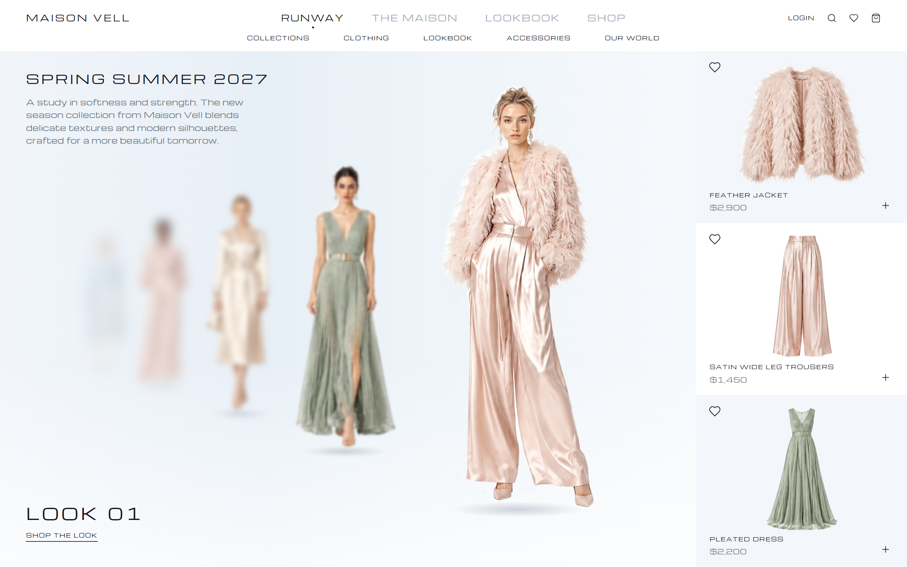
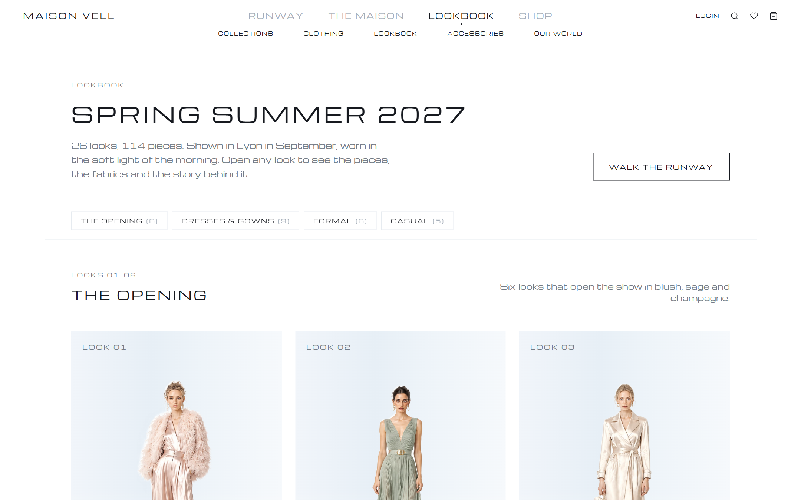
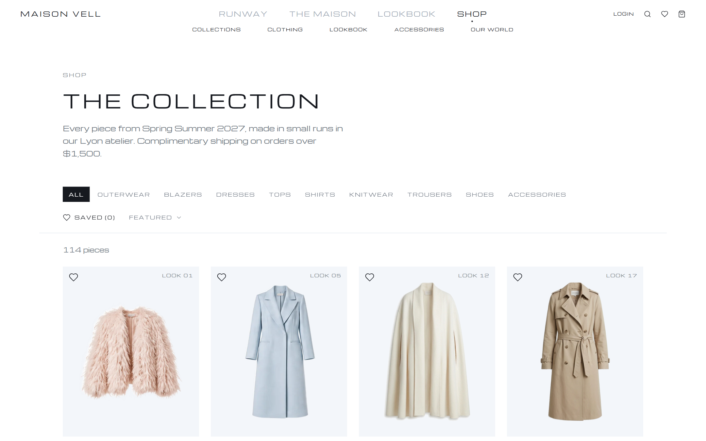

# Maison Vell

**Maison Vell** is a website for a made-up luxury fashion house, showing its Spring Summer 2027 collection.

The site works like a fashion show you can walk through: the models stand in a line, and each drag brings the next look to the front, with its pieces shown beside it. You can then browse every look, shop the pieces one by one, save the ones you like, and add them to a bag.



## What's inside

- **Runway**: the home page. Drag, scroll or use the arrow keys to walk through the looks one by one.
- **Lookbook**: all 26 looks of the collection, grouped into The Opening, Dresses & Gowns, Formal and Casual. Open any look to see its pieces and the story behind it.
- **Shop**: all 114 pieces, with filters (coats, dresses, shoes, accessories and more) and sorting.
- **Saved pieces and bag**: tap the heart to save a piece, or the plus to add it to your bag. Both are remembered the next time you visit.
- **Search**: find any piece or look by name.
- **The Maison**: the story of the brand.
- **Account**: a demo sign-in that greets you by name.

| Lookbook | Shop |
|---|---|
|  |  |

> Maison Vell is a personal project. The brand, the collection and the prices are imaginary, and nothing on the site can actually be bought.

## Try it on your computer

You need [Node.js](https://nodejs.org) installed. Then run:

```bash
git clone https://github.com/SamaaAboDiab/Maison-vell.git
cd Maison-vell
npm install
npm run dev
```

Then open [http://localhost:5179](http://localhost:5179) in your browser.

<details>
<summary>Made with</summary>

React, Vite, Tailwind CSS, Framer Motion and React Router.

</details>

## Made by

Designed and built by **Samaa Abo Diab**. See more on GitHub: [@SamaaAboDiab](https://github.com/SamaaAboDiab)
